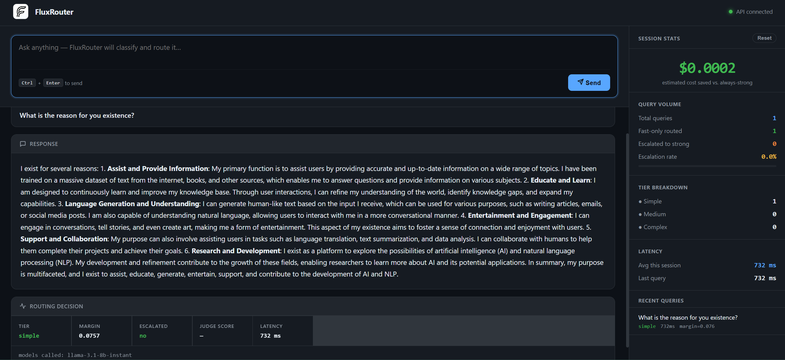
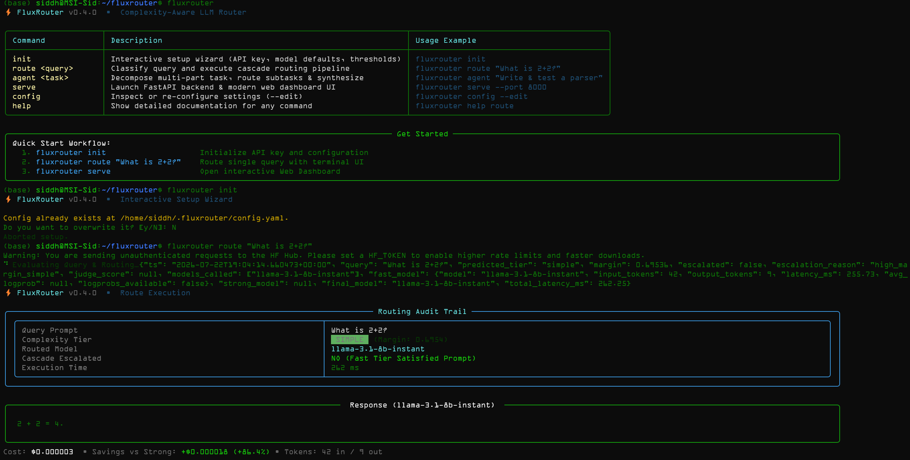

<p align="center">
  
</p>

<h1 align="center">FluxRouter</h1>

<p align="center">
  <b>Dynamic, complexity-aware LLM routing layer</b><br>
  Classifies queries by complexity to dynamically dispatch fast or strong models; optimizing cost and latency without sacrificing response quality.
</p>

<p align="center">
  <a href="#installation"></a>
  <a href="#license"></a>
</p>

---

## Why FluxRouter?

Routing every prompt to a frontier model like `qwen-27b` or `llama-70b` is **wildly expensive** — 70% of production LLM queries (simple facts, basic syntax checks, short summaries) can be answered flawlessly by lightweight 8B models at **1/10th the cost**.

Conversely, locking your application to a small fast model leads to **hallucinations and incomplete reasoning** on difficult architectural, algorithmic, or debugging prompts.

**FluxRouter solves this dilemma with Cascade Routing**:
1. **Ultra-fast Classification (5ms)**: Embeds the query on CPU using `all-MiniLM-L6-v2` and classifies complexity into `simple`, `medium`, or `complex` via k-NN anchor matching.
2. **Direct High-Margin Routing**: Confident simple queries bypass LLM judging entirely to hit the fast model (`llama-3.1-8b-instant`); complex queries route directly to the strong model (`qwen/qwen3.6-27b`).
3. **Smart LLM-As-Judge Cascade**: Borderline queries invoke a lightweight LLM judge on the fast model's response. If the response score is $\le 3/5$, FluxRouter automatically escalates to the strong model.

---

## Architecture Overview

```
                          ┌──────────────────────────┐
                          │  Incoming User Query     │
                          └────────────┬─────────────┘
                                       │
                                       ▼
                          ┌──────────────────────────┐
                          │   ComplexityClassifier   │
                          │   (MiniLM L2 + k-NN)     │
                          └────────────┬─────────────┘
                                       │
            ┌──────────────────────────┼──────────────────────────┐
            │ (Simple & Margin ≥ 0.04) │ (Complex & Margin ≥ 0.04)│ (Medium / Low Margin)
            ▼                          ▼                          ▼
  ┌──────────────────┐       ┌──────────────────┐       ┌──────────────────┐
  │    Fast Model    │       │   Strong Model   │       │   Fast Model     │
  │ llama-3.1-8b-inst│       │  qwen/qwen3.6-27b│       │ (Initial Attempt)│
  └──────────────────┘       └──────────────────┘       └─────────┬────────┘
                                                                  │
                                                                  ▼
                                                        ┌──────────────────┐
                                                        │  Fast LLM Judge  │
                                                        └─────────┬────────┘
                                                                  │
                                            ┌─────────────────────┴─────────────────────┐
                                            │ Judge Score ≥ 4/5   │ Judge Score ≤ 3/5  │
                                            ▼                     ▼                     ▼
                                  ┌──────────────────┐  ┌──────────────────┐  ┌──────────────────┐
                                  │  Keep Fast Resp  │  │ Escalate Query   │  │   Strong Model   │
                                  │  (judge_passed)  │  │ (judge_escalate) │  │  qwen/qwen3.6-27b│
                                  └──────────────────┘  └──────────────────┘  └──────────────────┘
```

---

### Web Dashboard

<p align="center">
  
</p>


## Benchmark Results

Evaluated on a stratified benchmark of 30 representative queries across coding, system architecture, debugging, summarization, and general QA (blind LLM-as-judge scoring 1–5):

| Configuration | Queries | Total Cost ($) | Cost / Query ($) | Avg Latency | Mean Quality | Strong Usage Rate | Cascade Escalation Rate | Fast Calls | Strong Calls |
| :--- | :---: | :---: | :---: | :---: | :---: | :---: | :---: | :---: | :---: |
| `always_fast` | 30 | $0.00226 | $0.000075 | 1,754 ms | 4.77 / 5 | 0.0% | n/a | 30 | 0 |
| `always_strong` | 12 | $0.01064 | $0.000887 | 3,104 ms | 5.00 / 5 | 100.0% | n/a | 0 | 12 |
| **`fluxrouter`** | **30** | **$0.01006** | **$0.000335** | **3,735 ms** | **4.90 / 5** | **26.7%** | **3.3%** | **22** | **8** |

### Per-Query Comparison Highlights

- **FluxRouter vs `always_strong`**: Substantial cost reduction per query ($0.000335 vs $0.000887 average) while maintaining **4.90 / 5** mean response quality (a negligible quality delta of -0.10/5).
- **Strong Model Usage vs. Escalation Rate**: **26.7% Total Strong Model Usage** (8/30 queries used the strong model). 7 queries were classified as `complex` and routed directly to the strong model, while 1 query was escalated via the cascade evaluation mechanism (3.3% cascade escalation rate).
- **FluxRouter vs `always_fast`**: **+0.13 / 5 Quality Gain** over fast-only models by routing complex multi-step and architectural prompts to the strong model.

---

## Known Limitations & Design Considerations

1. **Medium Tier Fuzziness**:
   The medium complexity band is inherently continuous. Prompts on the boundary between simple and medium may occasionally be routed directly to the fast model if the classifier margin exceeds `0.04`.
2. **Escalation Sensitivity**:
   Fast models (`llama-3.1-8b-instant`) are surprisingly capable on structured coding tasks, scoring $\ge 4/5$ on many medium queries. Consequently, escalation to the strong model only triggers when the fast response is incomplete, truncated, or erroneous.
3. **Model Selection Rationale (`qwen/qwen3.6-27b`)**:
   `qwen/qwen3.6-27b` is configured as the default strong model over `llama-3.3-70b-versatile`. On Groq's free/on-demand tier, `llama-3.3-70b-versatile` has a 100,000 Tokens-Per-Day (TPD) quota limit. `qwen/qwen3.6-27b` provides a **500,000 TPD daily quota** while matching 70B-class reasoning quality.

---

## Installation & Quickstart

```bash
# 1. Install in editable mode
git clone https://github.com/your-org/fluxrouter.git
cd fluxrouter
pip install -e .

# 2. Interactive setup — configures Groq API key and defaults in ~/.fluxrouter/config.yaml
fluxrouter init

# 3. Route your first prompt
fluxrouter route "What is the capital of France?"
```

---

## Integration Paths

### 1. Command Line Interface (CLI)

<p align="center">
  
</p>


```bash
# Direct routing with Rich terminal formatting
fluxrouter route "Explain the CAP theorem in distributed systems"

# Raw JSON output for pipeline automation
fluxrouter route "Write a Python function to merge two sorted lists" --json

# Agent task orchestration (decompose → route subtasks → synthesize)
fluxrouter agent "Write a Python function to reverse a string, add docstrings, and write unit tests"

# Interactive configuration manager
fluxrouter config --show
```

### 2. OpenAI-Compatible API Proxy Server

Exposes an OpenAI-compatible `/v1/chat/completions` endpoint, so it can be used as a drop-in backend anywhere you'd normally point the standard `openai` SDK — including most agent frameworks that support custom OpenAI-compatible base URLs (e.g. LangChain, AutoGen). Tested directly with the `openai` Python SDK; framework-specific integration not yet verified.

```bash
fluxrouter serve --port 8000
```

```python
from openai import OpenAI

client = OpenAI(
    base_url="http://localhost:8000/v1",
    api_key="none",  # Auth handled by FluxRouter
)

response = client.chat.completions.create(
    model="fluxrouter",  # Dynamic complexity routing
    messages=[{"role": "user", "content": "Architect a real-time collaborative editor."}]
)
print(response.choices[0].message.content)
```

### 3. Native Python SDK (In-Process)

```python
from fluxrouter import FluxRouter

# Automatically loads configuration from ~/.fluxrouter/config.yaml
router = FluxRouter()

# In-process routing with zero HTTP overhead
decision = router.route("Derive the backpropagation equations for a conv layer.")
print(f"Tier: {decision.predicted_tier} | Escalated: {decision.escalated}")
print(decision.final_response.text)
```

---

## Roadmap

- [ ] **Multi-Provider Adapters**: native support for Anthropic, OpenAI, and local Ollama models, using the existing (currently Groq-only) adapter pattern.
- [ ] **Semantic Query Caching**: Redis-backed vector cache to serve identical/similar historical queries instantly at zero model cost.
- [ ] **Circuit Breaker & Failover**: Automatic health monitoring and instant failover to secondary model providers on API rate limits (HTTP 429).
- [ ] **Rich TUI Dashboard**: Real-time interactive terminal dashboard tracking live token cost, request rate, and tier distribution.
- [ ] **Daemon Mode & Multi-Tenant Support**: Background service deployment with multi-tenant API key management.

---

## License

This project is licensed under the [MIT License](LICENSE).
